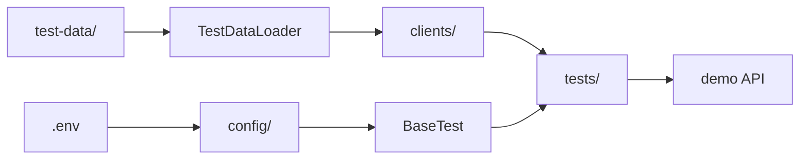

# Architecture

## Diagram



## Folder tree

```text
rest-assured-java-api-testing/
├── .env.example                  # template for local env vars (copy to .env, never commit .env)
├── .gitignore
├── ARCHITECTURE.md               # this file
├── README.md
├── pom.xml                       # Java 17, Rest Assured 5.5.0, TestNG 7.10.2, Jackson 2.17.2
├── docs/
│   ├── SETUP.md                  # install Java/Maven, first run
│   └── TESTING.md                # what is tested, how to run, reports
└── src/test/
    ├── java/com/mcsolo/
    │   ├── config/
    │   │   └── TestConfig.java       # all config: env var > -D > .env > config/{env}.properties
    │   │                             #   > config.properties > hard-coded demo-API fallback
    │   ├── clients/
    │   │   ├── PostsClient.java      # thin wrapper over JSONPlaceholder /posts calls
    │   │   ├── UsersClient.java      # thin wrapper over JSONPlaceholder /users + /comments calls
    │   │   └── AuthClient.java       # thin wrapper over httpbin auth calls
    │   ├── helpers/
    │   │   └── TestDataLoader.java   # loads JSON test data from test-data/
    │   └── tests/
    │       ├── BaseTest.java         # shared setup: base URIs, timeouts, specs, clients
    │       ├── PostsCrudTest.java    # CRUD on /posts (7 tests)
    │       ├── PostsDataDrivenTest.java  # data-driven /posts (6 tests)
    │       ├── UsersCrudTest.java    # CRUD on /users + /comments (8 tests)
    │       ├── AuthTest.java         # basic/bearer auth + custom header (7 tests)
    │       └── NegativeAndSchemaTest.java  # 404s, JSON schema, required fields (6 tests)
    └── resources/
        ├── config/
        │   ├── config.properties     # committed defaults (public demo APIs only)
        │   ├── dev.properties        # dev overrides
        │   └── prod.properties       # prod overrides (same demo APIs; no real prod exists)
        ├── schemas/
        │   └── post-schema.json      # JSON schema for a single post
        ├── test-data/                # CANONICAL test-data location (see below)
        │   ├── posts.json            # post payloads + expected list size
        │   ├── users.json            # known/unknown ids, filter user, unknown route
        │   ├── users-crud.json       # user payloads, known user/comment, expected counts
        │   └── auth.json             # dummy demo credentials, bearer token, custom header
        └── testng.xml                # TestNG suite: the 5 test classes
```

## Why each folder exists

| Folder | Why |
| --- | --- |
| `config/` | One place owns every setting (base URIs, timeouts, credentials). Tests never read env vars or files directly. |
| `clients/` | One thin wrapper per API area. A test reads as "do this, then check that"; the HTTP mechanics live in one place, so an endpoint change is fixed once. Clients hold no assertions and no test data. |
| `helpers/` | Shared test utilities that are not API clients. `TestDataLoader` is the only way tests read test data. |
| `tests/` | The actual test cases, grouped by area. `BaseTest` holds only setup shared by every class. |
| `resources/config/` | Environment-specific settings on the classpath, so any machine can run the suite with no local files. |
| `resources/test-data/` | The canonical test-data location. Payloads, ids and dummy credentials live here as JSON, not in Java code. |
| `resources/schemas/` | JSON schemas for response-shape validation. |
| `docs/` | Setup and testing guides, so the README stays short. |

## Data flow

```text
env var / -D property / .env / config/{env}.properties / config.properties
        └─> TestConfig (one lookup, fixed precedence)
                └─> BaseTest.setUp()
                        ├─> RestAssured.baseURI + timeouts
                        ├─> requestSpec (JSON in/out)
                        ├─> PostsClient (JSONPlaceholder /posts)
                        ├─> UsersClient (JSONPlaceholder /users + /comments)
                        └─> AuthClient  (httpbin auth endpoints)

test-data/*.json ──> TestDataLoader ──> tests (payloads, ids, dummy credentials)
schemas/*.json  ──> tests (matchesJsonSchemaInClasspath)
```

Config and test data are separate on purpose: config answers "where do I
run and how do I connect", test data answers "what do I send and expect".
Neither lives in the test classes.

## Config precedence

Highest first: env var (`API_BASE_URL`) > JVM system property
(`-Dapi.baseUri=...`) > `.env` in the project root > `config/{env}.properties`
(`TEST_ENV` / `test.env`, default `dev`) > `config/config.properties` >
hard-coded fallback in `TestConfig`. The fallback exists only so the suite
runs with zero setup, and the only URLs ever hard-coded are the two public
demo APIs. See `docs/SETUP.md` for the full key list.

## How to add a new test

1. **New data?** Add it to `src/test/resources/test-data/*.json` first.
   Add a typed accessor to `TestDataLoader` if the data is reused, or use
   `TestDataLoader.load("test-data/<file>.json")` for a one-off.
2. **New endpoint?** Add a method to the matching client in
   `clients/` (`PostsClient`, `AuthClient`, or a new `*Client` class).
   Keep it to one HTTP call, no assertions.
3. **New test class?** Extend `BaseTest`, use `postsClient` / `usersClient` / `authClient`,
   keep every assertion in the test method. Register the class in
   `src/test/resources/testng.xml`.
4. **New config?** Add the key to `TestConfig` with an env var name, a
   system-property name and a fallback, then to `config/config.properties`,
   `dev.properties`, `prod.properties` and `.env.example`.
5. Run `mvn test` (or the single class, see `docs/TESTING.md`) and confirm
   the new test passes before committing.
